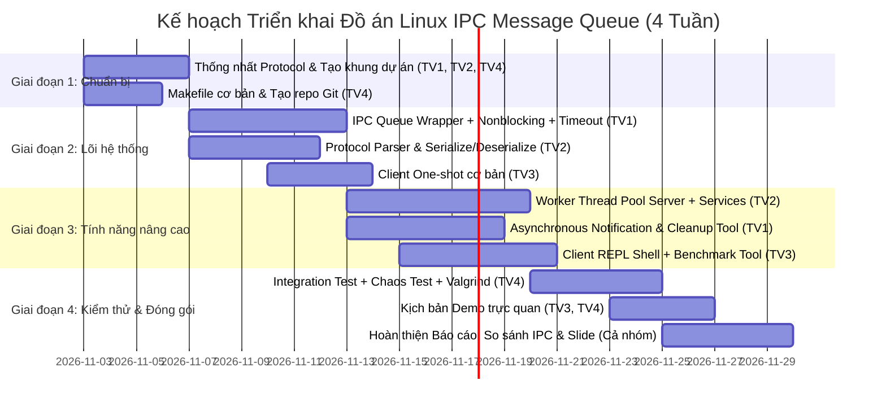

# Phân Chia Nhiệm Vụ Dự Án (Bản Nâng Cấp Chuyên Sâu)

# Shared Message Queues trong Linux IPC bằng ngôn ngữ C

---

## 1. Đánh Giá Tổng Quan & Định Hướng Nâng Cấp (Chuyên Môn)

### 1.1. Hiện trạng bản thiết kế ban đầu
- **Về độ rộng (Scope):** Bản thiết kế sơ khai chỉ xoay quanh 4 command cơ bản (`PING`, `TIME`, `FIB`, `UPPER`) và luồng giao tiếp tuần tự đơn giản. Tổng lượng mã nguồn ước tính chỉ khoảng 500–700 dòng C.
- **Về phân bổ công việc cho 4 người:**
  - *Thành viên 1 (Queue core):* Nhiệm vụ chỉ bọc các hàm `mq_*` cơ bản, khối lượng quá ít (~150 dòng C), dễ xong sớm và thiếu "đất diễn" kỹ thuật.
  - *Thành viên 2 (Server):* Server chạy vòng lặp đơn luồng (single-thread), nếu gặp tác vụ nặng (như tính toán CPU-bound) sẽ chặn toàn bộ hệ thống.
  - *Thành viên 3 (Client & Demo):* Chỉ gửi 1 request rồi thoát, kịch bản demo đơn điệu, thiếu công cụ đo kiểm tải và trải nghiệm người dùng tương tác.
  - *Thành viên 4 (Build, Test, Docs):* Nặng về tài liệu nhưng nhẹ về lập trình hệ thống; thiếu các công cụ phân tích an toàn bộ nhớ (Valgrind, AddressSanitizer) và tự động hóa CI/Test harness.

### 1.2. Định hướng nâng cấp chuẩn đồ án Hệ điều hành / Lập trình Hệ thống Linux (Điểm 10/10)
Để 4 thành viên đều có khối lượng công việc cân bằng, có chiều sâu kỹ thuật thực thụ và tự tin bảo vệ trước hội đồng, dự án được mở rộng thêm các trụ cột:
1. **IPC Core nâng cao:** Hỗ trợ Message Priority thực thụ, Non-blocking/Timed I/O (`mq_timedsend`, `mq_timedreceive`), và cơ chế bất đồng bộ `mq_notify` (Signal / Thread event) cùng công cụ dọn dẹp queue rác (`ipc_cleanup`).
2. **Server Concurrency & System Services:** Server đa luồng với **Worker Thread Pool** (xử lý song song nhiều request, không bị nghẽn), mở rộng tập lệnh Linux OS (`SYSINFO`, `STATS`, `CALC`, `ECHO`), xử lý Signal an toàn (`SIGINT`, `SIGTERM` dọn dẹp tài nguyên tuyệt đối).
3. **Client Ecosystem & Benchmark Tool:** Bổ sung **Interactive REPL Shell** (giao diện dòng lệnh tương tác trực tiếp) và **Load Generator / Benchmark Tool** (đo lường Throughput req/s, Latency p95/p99 khi hàng trăm client bắn cùng lúc).
4. **DevOps, Memory Sanitizers & Automated Test Harness:** Tích hợp AddressSanitizer (`-fsanitize=address,undefined`), kiểm tra rò rỉ bộ nhớ với Valgrind, bộ kịch bản Chaos Test (kill đột ngột, buffer overflow attack) và tài liệu so sánh chuyên sâu (POSIX mqueue vs FIFO vs UNIX Domain Sockets vs Shared Memory).

---

## 2. Quy Trình Phối Hợp & Git Workflow

### 2.1. Cấu trúc nhánh
- **Nhánh chính:** `main` (chỉ merge mã nguồn đã qua test và review).
- **Nhánh phát triển tích hợp:** `develop` (nhánh tích hợp chung trước khi phát hành phiên bản).
- **Các nhánh tính năng (Feature branches):**
  - `feature/tv1-ipc-mqueue-core`
  - `feature/tv2-server-threadpool`
  - `feature/tv3-client-repl-benchmark`
  - `feature/tv4-build-valgrind-testsuite`

### 2.2. Quy tắc làm việc nhóm
1. Tuyệt đối không commit trực tiếp vào `main` và `develop`.
2. Mỗi Pull Request (PR) phải có ít nhất **1 thành viên khác review và phê duyệt**.
3. Trước khi tạo PR, mã nguồn phải biên dịch sạch không warning (`-Wall -Wextra -Werror -pedantic`).
4. Không commit file binary, file `.o`, log, hoặc queue ảo `/dev/mqueue/*`.
5. Khi thay đổi cấu trúc protocol trong `protocol.h`, bắt buộc phải thông báo toàn nhóm để đồng bộ.

---

## 3. Phân Công Chi Tiết Cho Từng Thành Viên

### VanHuy: IPC Core Engine, Asynchronous Notification & Resource Management

#### Mục tiêu chuyên môn
Xây dựng lớp trừu tượng (abstraction layer) vững chắc cho POSIX Message Queue, đảm bảo an toàn bộ nhớ, hỗ trợ non-blocking, priority message, cơ chế bất đồng bộ `mq_notify` và công cụ phục hồi tài nguyên hệ thống.

#### Nhiệm vụ cụ thể
1. **Thiết kế & cài đặt thư viện lõi (`include/ipc_queue.h`, `src/ipc_queue.c`):**
   - Đóng gói an toàn các POSIX API: `mq_open`, `mq_send`, `mq_receive`, `mq_timedsend`, `mq_timedreceive`, `mq_close`, `mq_unlink`, `mq_getattr`, `mq_setattr`.
   - Cung cấp cơ chế phân cấp ưu tiên message (**Message Priority**): `PRIO_LOW (0)`, `PRIO_NORMAL (10)`, `PRIO_HIGH (20)`, `PRIO_URGENT (30)`.
   - Hỗ trợ cả 2 chế độ I/O: **Blocking** (chờ với timeout) và **Non-blocking** (`O_NONBLOCK`).
2. **Cơ chế Asynchronous Notification (`mq_notify`):**
   - Nghiên cứu và hiện thực hóa việc đăng ký nhận thông báo bất đồng bộ qua POSIX Signal (`SIGEV_SIGNAL`) hoặc tạo thread mới (`SIGEV_THREAD`) khi có tin nhắn mới vào queue rỗng.
3. **Tiện ích giám sát và dọn dẹp hệ thống (`src/ipc_cleanup.c`):**
   - Viết binary độc lập `bin/ipc_cleanup` hỗ trợ quét thư mục `/dev/mqueue/`, phát hiện các queue mồ côi (orphaned queues) do tiến trình bị crash đột ngột (`kill -9`) và ép dọn dẹp sạch sẽ.
4. **Kiểm soát lỗi IPC chặt chẽ:**
   - Xử lý triệt để các mã lỗi: `EEXIST`, `ENOENT`, `EMSGSIZE`, `EAGAIN`, `ETIMEDOUT`, `EACCES`, `EINTR`.

#### Các hàm & cấu trúc đề xuất
```c
// include/ipc_queue.h
typedef enum {
    MSG_PRIO_LOW = 0,
    MSG_PRIO_NORMAL = 10,
    MSG_PRIO_HIGH = 20,
    MSG_PRIO_URGENT = 30
} MessagePriority;

typedef struct {
    int max_messages;       // Thường là 10
    size_t max_msg_size;    // Thường là 256 bytes
    int is_nonblocking;     // 1: O_NONBLOCK, 0: Blocking
} QueueConfig;

mqd_t ipc_queue_open(const char *name, int oflag, mode_t mode, const QueueConfig *config);
int ipc_queue_send(mqd_t mqdes, const char *msg_ptr, size_t msg_len, MessagePriority prio);
int ipc_queue_send_timeout(mqd_t mqdes, const char *msg_ptr, size_t msg_len, MessagePriority prio, unsigned int timeout_ms);
ssize_t ipc_queue_receive(mqd_t mqdes, char *msg_ptr, size_t msg_len, unsigned int *prio);
ssize_t ipc_queue_receive_timeout(mqd_t mqdes, char *msg_ptr, size_t msg_len, unsigned int *prio, unsigned int timeout_ms);
int ipc_queue_close(mqd_t mqdes);
int ipc_queue_unlink(const char *name);
int ipc_queue_register_notify(mqd_t mqdes, void (*notify_function)(union sigval));
```

#### Sản phẩm bàn giao (Deliverables)
- Module `src/ipc_queue.c` và header `include/ipc_queue.h`.
- Tiện ích dọn dẹp `src/ipc_cleanup.c` -> biên dịch ra `bin/ipc_cleanup`.
- Unit test riêng cho IPC Core: `tests/test_ipc_queue.c`.

---

### THÀNH VIÊN 2: Ngọc Huy: Server Architecture, Multi-Threading Worker Pool & System Services

#### Mục tiêu chuyên môn
Xây dựng Server xử lý tin nhắn trung tâm có khả năng mở rộng cao, áp dụng mô hình **Multi-threaded Worker Pool** (POSIX pthreads) để giải quyết triệt để bài toán thắt cổ chai khi có nhiều client đồng thời, cùng hệ thống dịch vụ đa dạng.

#### Nhiệm vụ cụ thể
1. **Thiết kế Protocol & Data Serialization (`include/protocol.h`, `src/protocol.c`):**
   - Chuẩn hóa định dạng Request: `<CLIENT_PID>|<COMMAND>|<PRIORITY>|<PAYLOAD>`.
   - Chuẩn hóa định dạng Response: `<STATUS_CODE>|<EXEC_TIME_MS>|<PAYLOAD>`.
   - Viết parser an toàn, kiểm tra độ dài buffer, chống buffer overflow và injection.
2. **Kiến trúc Server Đa Luồng (`src/server.c`, `src/worker_pool.c`):**
   - *Master Thread (Listener):* Liên tục lắng nghe tại queue `/shared_requests`. Khi nhận được request, đưa vào hàng đợi công việc nội bộ (Internal Job Queue).
   - *Worker Thread Pool (N worker threads):* Lấy request từ Job Queue, thực thi command độc lập và gửi response về `/shared_responses_<PID>` của client tương ứng. Không để một request nặng làm chậm các request khác.
3. **Triển khai các Dịch vụ Nghiệp vụ (System Services):**
   - `PING`: Trả về `PONG` (Heartbeat check).
   - `TIME`: Trả về thời gian hệ thống định dạng chuẩn ISO 8601 / RFC 2822.
   - `FIB <n>`: Tính số Fibonacci (xác thực số nguyên không âm $0 \le n \le 45$).
   - `UPPER <str>`: Biến đổi chuỗi thành chữ hoa.
   - `SYSINFO`: Đọc và trích xuất thông tin Linux từ `/proc/loadavg`, `/proc/meminfo`, `/proc/uptime` (đặc trưng chuyên sâu của Linux Systems).
   - `STATS`: Trả về số liệu vận hành server (tổng số request đã xử lý, số request lỗi, số worker đang bận, uptime của server).
4. **Graceful Shutdown & Signal Handling:**
   - Bắt các tín hiệu `SIGINT` (Ctrl+C), `SIGTERM`.
   - Khi nhận tín hiệu: Ngừng nhận request mới, đợi các worker hoàn thành công việc đang dở (drain workers), hủy queue `/shared_requests`, giải phóng bộ nhớ sạch sẽ trước khi thoát.

#### Sản phẩm bàn giao (Deliverables)
- Mã nguồn Server: `src/server.c`, `src/worker_pool.c`, `include/worker_pool.h`.
- Mã nguồn Protocol: `src/protocol.c`, `include/protocol.h`.
- Unit test kiểm thử parser: `tests/test_protocol.c`.

---

### THÀNH VIÊN 3: Client Ecosystem, Interactive REPL & Load Generator / Benchmarking

#### Mục tiêu chuyên môn
Xây dựng hệ sinh thái phía Client hoàn chỉnh, bao gồm giao diện tương tác người dùng thời gian thực (Interactive REPL Shell) và công cụ giả lập tải cực hạn (Stress & Benchmark Tool) để kiểm chứng năng lực của hệ thống IPC.

#### Nhiệm vụ cụ thể
1. **Phát triển Client đa chế độ (`src/client.c`):**
   - **Chế độ 1 - One-shot Mode:** Chạy 1 lệnh từ command-line rồi thoát (phục vụ script và kiểm thử):
     ```bash
     ./bin/client --cmd "FIB 20" --prio HIGH
     ```
   - **Chế độ 2 - Interactive REPL Mode:** Giao diện shell tương tác có dấu nhắc lệnh `client-ipc> `, hỗ trợ nhập lệnh liên tục, hiển thị trạng thái kết nối, mã màu ANSI trực quan (Success: xanh, Error: đỏ).
   - Quản lý vòng đời queue response riêng `/shared_responses_<PID>`: Tạo khi khởi động, dọn dẹp triệt để khi thoát hoặc bị gián đoạn.
2. **Cơ chế Timeout & Deadlock Prevention:**
   - Dùng `mq_timedreceive()`: Nếu server không phản hồi sau $T$ giây (mặc định 3s), client thông báo lỗi timeout rõ ràng thay vì bị treo vô tận.
3. **Phát triển Công cụ Đo tải & Benchmark (`src/benchmark.c`):**
   - Viết chương trình `bin/benchmark` độc lập:
     - Cho phép cấu hình số tiến trình client đồng thời (concurrency: 5, 10, 50, 100 process).
     - Cho phép cấu hình tổng số request (1.000 – 10.000 requests).
     - Đo đạc và in báo cáo hiệu năng:
       + Throughput: Requests/sec (RPS).
       + Round-Trip Latency: Min, Max, Average, p95, p99 (tính bằng microsecond $\mu s$).
       + Tỷ lệ gói tin thành công / lỗi / timeout.
4. **Kịch bản Demo Tự Động (`demo/demo.sh`):**
   - Viết script tự động chạy kịch bản trực quan cho buổi bảo vệ đồ án:
     - Kịch bản 1: Kiểm tra lần lượt các lệnh chức năng.
     - Kịch bản 2: 10 client đồng thời gửi request với các mức ưu tiên khác nhau (Priority Inversion Check).
     - Kịch bản 3: Xử lý tình huống server tắt đột ngột hoặc gửi command lỗi.

#### Sản phẩm bàn giao (Deliverables)
- Mã nguồn Client: `src/client.c` (biên dịch ra `bin/client`).
- Mã nguồn Benchmark Tool: `src/benchmark.c` (biên dịch ra `bin/benchmark`).
- Script demo hoàn chỉnh: `demo/demo.sh`.

---

### THÀNH VIÊN 4: Build System, Automated Test Harness, Memory Profiling & Documentation

#### Mục tiêu chuyên môn
Đảm bảo toàn bộ dự án tuân thủ tiêu chuẩn kỹ thuật phần mềm chuẩn công nghiệp: build tự động, phát hiện rò rỉ bộ nhớ (Memory Leaks/Corruption) bằng Valgrind/ASan, bộ test tự động toàn diện và bộ hồ sơ tài liệu/slide bảo vệ hoàn hảo.

#### Nhiệm vụ cụ thể
1. **Thiết kế Makefile chuyên nghiệp (`Makefile`):**
   - Hỗ trợ các targets: `all`, `server`, `client`, `benchmark`, `cleanup`, `test`, `clean`.
   - Chế độ biên dịch nghiêm ngặt: `-Wall -Wextra -Werror -pedantic -std=gnu11`.
   - Target hỗ trợ Debug & Sanitizer: `make debug` (bật `-fsanitize=address,undefined -g`).
   - Target kiểm tra rò rỉ bộ nhớ: `make valgrind` (chạy Valgrind Memcheck tự động).
2. **Xây dựng Automated Integration Test Suite (`tests/`):**
   - Viết `tests/test_integration.sh`: Script tự động spawn server ngầm, kích hoạt hàng loạt test cases, kiểm tra mã trả về, xác minh queue không bị rò rỉ trong `/dev/mqueue/`, và tự động tắt server.
   - Viết **Chaos / Resilience Tests:**
     - Test gửi payload tối đa 256 bytes và vượt quá 256 bytes.
     - Test gửi ký tự đặc biệt, định dạng sai (`|||`).
     - Test kill đột ngột client/server xem queue có bị kẹt không.
3. **Báo cáo Chuyên sâu về Linux IPC (`docs/` & `README.md`):**
   - Viết báo cáo phân tích, so sánh kỹ thuật:
     - **POSIX Message Queue vs System V Message Queue**.
     - **Message Queue vs UNIX Domain Sockets vs Shared Memory + Semaphore**.
     - Khi nào nên dùng loại nào trong kiến trúc hệ thống phân tán nội bộ Linux?
   - Vẽ sơ đồ kiến trúc hệ thống (Architecture Diagram) và sơ đồ tuần tự (Sequence Diagram) bằng Mermaid / SVG.
4. **Soạn thảo Slide Báo cáo & Video/Demo Script:**
   - Chuẩn bị slide thuyết trình (tối thiểu 15-20 slide) phân định rõ phần nói của từng bạn.
   - Chuẩn bị Checklist nghiệm thu trước khi nộp bài.

#### Sản phẩm bàn giao (Deliverables)
- Hệ thống build: `Makefile`.
- Bộ kịch bản kiểm thử: `tests/test_integration.sh`, `tests/test_chaos.sh`.
- Tài liệu đồ án: `README.md`, `docs/IPC_COMPARISON.md`, `docs/ARCHITECTURE.md`.
- Slide thuyết trình: `docs/presentation_slides.pdf` (hoặc PPTX).

---

## 4. Ma Trận Kỹ Năng & Khối Lượng Công Việc Đối Chiếu

| Thành viên | Trọng tâm chính | Mã nguồn phụ trách | Khối lượng ước tính | Chiều sâu kỹ thuật (Technical Depth) |
|---|---|---|:---:|---|
| **TV1** | IPC Core & System Cleanup | `ipc_queue.c`, `ipc_cleanup.c`, `ipc_queue.h` | 300 - 450 dòng C | POSIX IPC internals, Non-blocking, Timeout, Message Priority, `mq_notify`, `/dev/mqueue` filesystem |
| **TV2** | Server & Concurrency Engine | `server.c`, `worker_pool.c`, `protocol.c` | 450 - 600 dòng C | Pthreads, Thread Pool, Synchronization (Mutex/Cond), Signal Handling, Protocol Serialization, Linux `/proc` stats |
| **TV3** | Client, REPL & Benchmarking | `client.c`, `benchmark.c`, `demo.sh` | 400 - 550 dòng C + Script | Interactive CLI, High-concurrency Load Generator, Throughput/Latency calculation, Multi-process orchestration |
| **TV4** | Build, Test Harness & Analysis | `Makefile`, `test_integration.sh`, Test cases, Docs | 350+ dòng Script/C + Báo cáo | Make toolchain, AddressSanitizer, Valgrind profiling, Chaos Testing, Phân tích so sánh IPC Architecture |

---

## 5. Lộ Trình Triển Khai Theo Giai Đoạn (Milestones)



### Chi tiết các mốc:
- **Mốc 1 (Tuần 1):** Khởi tạo khung dự án, thống nhất cấu trúc thư mục, chuẩn hóa struct trong `protocol.h`, dựng Makefile ban đầu.
- **Mốc 2 (Tuần 2):** Hoàn thành `ipc_queue.c` và unit test. Ghép nối thành công 1 Client gửi `PING` và 1 Server phản hồi `PONG` thông qua message queue.
- **Mốc 3 (Tuần 3):** Triển khai Worker Thread Pool cho Server. Hoàn thiện các lệnh nâng cao (`SYSINFO`, `FIB`, `STATS`). Nâng cấp Client REPL và công cụ `benchmark`.
- **Mốc 4 (Tuần 4):** Chạy kiểm thử toàn diện với Valgrind và Sanitizer. Khắc phục 100% cảnh báo và lỗi rò rỉ tài nguyên. Tổng duyệt kịch bản demo và slide bảo vệ.

---

## 6. Phân Công Nhiệm Vụ Thuyết Trình Bảo Vệ (Oral Defense)

Khi đứng trước hội đồng chấm thi, việc chia phần thuyết trình hợp lý sẽ giúp giảng viên thấy được sự đồng đều và đóng góp thực chất của từng thành viên:

| Thành viên | Chủ đề thuyết trình chuyên sâu | Câu hỏi bảo vệ dự kiến cần chuẩn bị |
|---|---|---|
| **Thành viên 1** | **Bản chất POSIX Message Queue & Quản lý Tài nguyên OS**<br>- Cơ chế lưu trữ của `/dev/mqueue` trong Linux VFS.<br>- So sánh Blocking vs Non-blocking vs Asynchronous `mq_notify`.<br>- Thuật toán ưu tiên Message Priority hoạt động thế nào trong Kernel? | *Tại sao khi tiến trình bị `kill -9` thì queue vẫn còn trong hệ thống? Công cụ `ipc_cleanup` xử lý việc này ra sao?* |
| **Thành viên 2** | **Kiến trúc Server Concurrency & Thiết kế Protocol**<br>- Mô hình Thread Pool: Worker synchronization dùng Mutex & Condition Variable.<br>- Thiết kế giao thức an toàn, chống tràn bộ nhớ đệm (Buffer Overflow).<br>- Kỹ thuật Graceful Shutdown và Signal Handling trên Linux. | *Nếu 100 client cùng gửi lệnh `FIB 45` thì Server xử lý ra sao để không làm sập hàng đợi?* |
| **Thành viên 3** | **Trải nghiệm Client & Phân tích Đánh giá Tải (Benchmarking)**<br>- Thiết kế kiến trúc REPL Shell không chặn.<br>- Phương pháp đo lường Throughput và Latency (p95, p99).<br>- Phân tích hiện tượng tranh chấp (Contention) khi nhiều tiến trình client cùng ghi vào một queue. | *Làm sao đảm bảo Client A không bao giờ đọc nhầm response của Client B trong mô hình Shared Message Queues?* |
| **Thành viên 4** | **Kiểm định Chất lượng (QA), Độ tin cậy & Đánh giá So sánh**<br>- Quy trình bắt lỗi rò rỉ bộ nhớ với AddressSanitizer & Valgrind.<br>- Kịch bản Chaos Testing: Xử lý ngoại lệ khi hệ thống gặp lỗi.<br>- So sánh hiệu năng và ưu/nhược điểm giữa Message Queue và Socket / Shared Memory. | *Tại sao chọn POSIX Message Queue thay vì UNIX Domain Socket hay Shared Memory trong bài toán này? Đánh đổi là gì?* |

---

## 7. Checklist Nghiệm Thu Đồ Án (Definition of Done - DoD)

- [ ] Toàn bộ mã nguồn biên dịch thành công không có cảnh báo (`-Wall -Wextra -Werror -pedantic`).
- [ ] Không rò rỉ bộ nhớ (Valgrind báo cáo `0 errors from 0 contexts`, `no leaks are possible`).
- [ ] Không sót bất kỳ message queue rác nào trong `/dev/mqueue/` sau khi kết thúc chương trình.
- [ ] Server xử lý đồng thời ít nhất 50 client mà không bị nghẽn (nhờ Worker Thread Pool).
- [ ] Client có đầy đủ cả chế độ CLI one-shot và Interactive REPL Shell.
- [ ] Công cụ Benchmark xuất báo cáo Throughput và Latency rõ ràng.
- [ ] Xử lý an toàn tín hiệu `SIGINT/SIGTERM` với cơ chế Graceful Shutdown.
- [ ] Toàn bộ các test cases tự động trong `tests/test_integration.sh` đều PASSED.
- [ ] Tài liệu `README.md` hướng dẫn rõ ràng từ lúc clone repo đến lúc chạy demo.
- [ ] Có tài liệu so sánh chuyên sâu các cơ chế IPC trên Linux và slide thuyết trình hoàn chỉnh.
